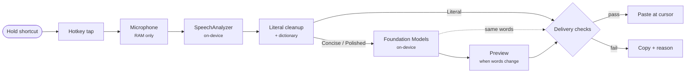

# Speak

Hold a key, talk, let go: clean text appears at your cursor in any Mac app, all on-device.

[](https://github.com/sbui056/speak/actions/workflows/ci.yml)
[](LICENSE)


## Features

- **Push to talk anywhere.** Hold Right Option (or Right Command / Right Control), speak, release. The text is pasted where your cursor is, and your clipboard is put back afterwards.
- **On-device speech recognition** with Apple's SpeechAnalyzer, with a live preview of the words while you talk.
- **Three modes.** *Literal* types exactly what you said, with spacing tidied and dictionary spellings applied. *Concise* and *Polished* rewrite it with Apple Intelligence's on-device model.
- **No surprise rewrites.** When a rewrite changes your words, a preview shows the difference first. Choose Insert, Insert literal, Edit, or Copy. You can set **Show preview** to *Always*, *When words change* (the default), or *Never*.
- **Dictionary** for names and jargon ("Siobhan", "Kubernetes"). Speak passes the terms to the recognizer and fixes near-misses.
- **Undo insert** for 30 seconds after a paste, and **Paste / Copy last transcript** from the menu bar.
- **Safe fallbacks.** If Speak can't paste (no text field, secure input, keys still held), it copies the text and tells you why.
- **Optional history** of your last 50 dictations, as text only. It's off by default.

## See it

**Polished: preview the rewrite, ⏎ to insert**


**Works in any app**


**Teach it names**


## Install

**You need:** macOS 26 (Tahoe) on Apple Silicon, plus the Swift toolchain (Xcode or the Command Line Tools: `xcode-select --install`). Apple Intelligence is only needed for Concise and Polished.

```sh
git clone https://github.com/sbui056/speak.git
cd speak
scripts/make-identity.sh   # once: creates a local self-signed code-signing identity
scripts/bundle.sh          # builds, signs, installs to ~/Applications/Speak.app, and launches
```

The stable local identity keeps macOS permission grants across rebuilds. Speak then asks for three permissions:

| Permission | Why Speak needs it |
|---|---|
| **Microphone** | To hear what you dictate. Audio stays in memory and is never written to disk. |
| **Input Monitoring** | To notice when you hold the shortcut key. The key tap only listens and never blocks or changes keys. |
| **Accessibility** | To paste the text at your cursor, check that a text field is focused, and offer Undo. |

After you grant Input Monitoring, Speak asks to relaunch once, because macOS only applies that permission to a new process.

## Usage

| Action | How |
|---|---|
| Dictate | Hold **Right Option**, speak, and release |
| Cancel while talking | **Esc**, or press another key with the shortcut |
| Preview: insert the rewrite | **⏎** |
| Preview: insert your exact words | **⌥⏎** |
| Preview: copy instead | **⌘C** |
| Preview: discard | **Esc** |
| Change mode / Show preview | Menu bar icon → **Mode** |
| Undo the last paste | Menu bar icon → **Undo insert** (within 30 s) |
| Paste or copy the last transcript | Menu bar icon → **Paste last transcript** / **Copy last transcript** |
| Add names and jargon | Menu bar icon → **Dictionary…** |
| See your history (when it's on) | Menu bar icon → **History…** |

In Settings you can check permissions, choose the shortcut key and the language, see Apple Intelligence status, set Show preview, turn history on or off, set launch at login, copy diagnostics, and check that Speak can type (it types a fixed sample sentence; it doesn't use the microphone).

## Privacy

- **No network.** Speak contains no networking code and has no network entitlement. `scripts/check-privacy.sh` enforces both in CI.
- **No audio on disk.** Audio lives in memory for the length of one dictation.
- **History is off by default.** When you turn it on, it keeps the text of your last 50 dictations in `~/Library/Application Support/Speak/`. That folder is private to your user account and excluded from backups. **Delete all history** removes the entries for good.
- **Logs contain no text.** Logs record states, timings, and error codes only. **Copy diagnostics** follows the same rule.

## Architecture



All decisions live in `SpeakCore`, a pure state machine with no UI or system frameworks. It reaches the system through small protocols, and the `Speak` target supplies the real adapters. See [docs/architecture/v1.md](docs/architecture/v1.md) for the state machine, delivery rules, and design decisions.

## Testing

```sh
scripts/test.sh            # the SpeakCore suite, with fakes for audio, speech, keys, and the model
scripts/check-privacy.sh   # no networking, no text in public logs, SpeakCore stays framework-free
scripts/soak.sh            # 100 fake dictations in a debug build, then footprint growth and leaks
scripts/latency.sh         # latency per mode and per stage, plus memory, from Speak's own logs
```

The tests cover the session state machine, delivery rules, clipboard restore, undo, the rewrite guard (including prompt-injection attempts), the dictionary, and history storage. They need no microphone, permissions, or Apple Intelligence, so they run on CI.

## Latency

Time from releasing the key to the text appearing, on an M2 MacBook Air, over 40+ dictations per mode, from Speak's own timing logs:

| Mode | Median | p90 |
|---|---|---|
| Literal | 0.11 s | 0.15 s |
| Polished (no preview) | 0.99 s | 1.95 s |

## Known limits

- The shortcut key and Esc also reach the focused app, because the key tap only listens.
- Undo is best-effort. Speak only offers it while the same app and field are focused and the text length still matches.
- Concise and Polished need Apple Intelligence turned on. Without it, Speak uses Literal.
- On keyboard layouts where Right Option is AltGr, choose Right Command as the shortcut.
- Terminal editors that remap ⌘V may not paste. Use Copy last transcript instead.
- Remote-desktop and VM apps read the clipboard slowly. If a paste comes out wrong, add the app's bundle ID to `slowPasteApps` in `Sources/SpeakCore/Constants.swift`.

## License

[MIT](LICENSE)
