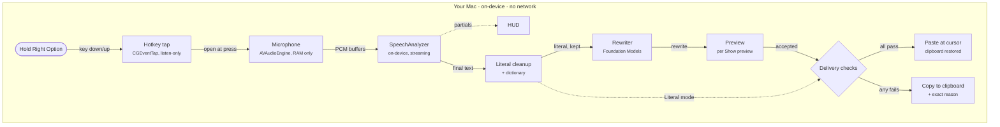
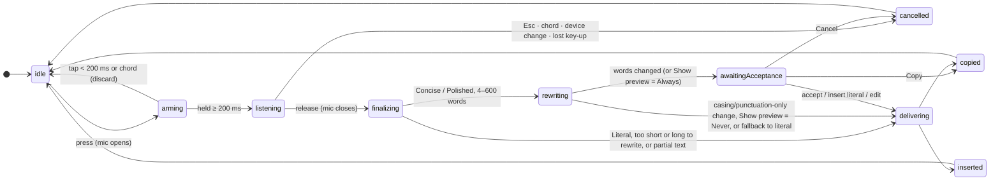
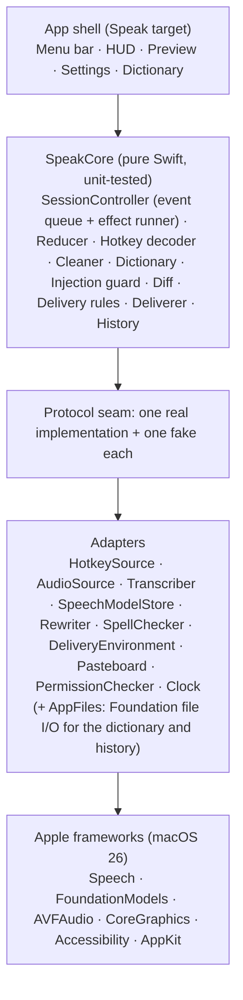

# Speak — Architecture v1

> Status: **as built**, October 2026. The design baseline plus what the implementation added (see [As built](#as-built)). Open [`v1.html`](v1.html) in a browser for the interactive walkthrough.

Speak is a macOS menu-bar app. Hold a key, talk, let go, and clean text appears at your cursor in any app. Speech recognition and rewriting run on your Mac with Apple frameworks:
- **0** network calls
- **0** bytes of audio on disk
- **$0** running cost
- **≤1.5 s** median release-to-text target in Literal mode (≤3 s with a rewrite); measured 0.12 s Literal, 0.58 s Polished

## Pipeline

## Session state machine

One pure reducer, `reduce(state, event) -> (state, [effect])`, owns every session. `SessionController` feeds it and runs the effects. All inputs arrive on a single ordered queue, so no two events can race. Every async result carries a session token, and results from an old session are dropped.

The code has seven phases, `idle` through `delivering`; `inserted`, `copied`, and `cancelled` are how a session ends, shown in the HUD, and each returns to `idle`. The microphone is open **only** in `arming` and `listening`. Watchdogs bound every wait: a transcriber start (3 s), finalize (5 s, then the partial text is used), a rewrite (2.5 s, then literal), and a lost key-up (300 ms).

## Delivery checks

The checks are evaluated in order, immediately before pasting. The first failure copies the text and names the reason.

| # | Check | If it fails |
|---|---|---|
| 0 | Is there any text? | nothing: "Didn't catch that" |
| 1 | Is Accessibility granted (checked fresh)? | copy: Accessibility not granted |
| 2 | Is secure input off (password fields)? | copy: Secure input is on |
| 3 | Is it the same app as at key press (by PID)? | copy: App changed |
| 4 | Is a text field focused (when the system can tell)? | copy: No text field focused |
| 5 | Is it the same field as at key press? | copy: Focus moved |
| 6 | Are the modifier keys released? | copy: Release modifier keys |
| 7 | All clear | **paste** with ⌘V, then restore the clipboard unless it changed |

## Layers

`SpeakCore` never imports AppKit, AVFoundation, Speech, or FoundationModels, and CI enforces this. The whole pipeline runs in tests and CI with fakes and no microphone.

## Privacy guarantees and how they're enforced

| Guarantee | Enforced by |
|---|---|
| No network | No networking code or entitlement; a CI privacy check fails on any network API |
| No audio on disk | Buffers stream and are released; the CI privacy check fails on any file I/O in the audio path |
| The mic opens only while you hold the key | Two mic states, closed on every exit; a property test over 1,000 random event sequences |
| No silent rewrites (by default) | Changed words need explicit acceptance; rejecting leaves the literal byte-identical. Show preview = *Never* is an opt-in; then Paste last returns the literal |
| No sensitive logs | Only enums, numbers, and durations are logged publicly; never text, app names, or window titles. Copy diagnostics follows the same rule |
| History is opt-in | Off by default; text only, last 50, in a 0700 folder with 0600 files excluded from backups; Delete all also removes set-aside corrupt copies |

## Failure modes and design responses

| Failure mode | Design response |
|---|---|
| Two events race inside one transition | A single ordered queue feeding a synchronous reducer |
| Late result from a cancelled session | Session tokens on every async result; mismatches are dropped |
| Speech or model framework hangs | Watchdogs on start, finalize, and rewrite; a restart prompt after repeated hangs |
| ⌘V sent while Option is still held | Wait for modifiers; explicit flags; layout-resolved "v" key |
| Accepting the preview pastes into Speak itself | Re-activate the original app by PID before delivery |
| Clipboard restored before a slow app reads it | Longer delay for slow apps; restore only if unchanged; skip lazy types |
| First word lost to the tap/hold debounce | The mic opens at press; taps and chords are discarded |
| Rewrite answers or obeys the dictation | Bracket stripping, single tagged output, length and overlap checks, literal fallback |
| On-device model slow on its first call | Prewarm at launch; at key press in a rewrite mode, prepare the session the rewrite will use |
| Dictionary "fixes" real words | Fuzzy matching only for words the spellchecker flags |
| Polished "fixes" a fact | Keep guard: numbers, days, names, acronyms, terms, unknown words and negations must survive, other changes must be grammar or sound-alikes |

## As built

What the implementation added to the baseline above, by area.

**Keys.** A pure `HotkeyDecoder` turns raw `flagsChanged`/`keyDown` events into press, release, chord, and cancel. It uses the device-specific modifier bit, so a held Left Option never counts and autorepeat is ignored. The tap runs on its own thread and is re-created after sleep. If macOS disables the tap, the live key state is re-read so a lost key-up can't keep the mic open.

**Timers.** Every watchdog is a `Deadline` whose end time is fixed when it's created, not when its task first runs, so timers don't drift later under load.

**Recognition.** The recognizer ignores contextual strings, so the dictionary works on its output instead. It reports a few alternative readings per finished segment; Speak takes the first one that spells a dictionary term (or a replacement's output) the top reading misheard, if it changes only a few words around that term, keeps every term the top reading had, and repeats no word. For an everyday-word term ("cache", "main"), the recognizer must also have been unsure of the words it replaces, so a clearly spoken "cash" stays "cash". On synthetic speech this raised target-word hits from 160 to 171 of 200 with no regressions. When the key is released, the audio converter is drained and 300 ms of generated silence follows the last buffer.

**Literal step.** After the final transcript: tidy whitespace, capitalize the first letter, apply replacement pairs ("pool request" → "pull request": whole words, longest first, one pass), then dictionary correction. Exact phrase matches take the term's casing; a term with no capital keeps the spoken casing. A near-miss (one edit) is fixed only when the spell checker flags the word and the match is unambiguous. An optional pack adds about 70 common tech terms.

**Rewrite and preview.** The on-device model gets the dictation inside an injection guard and must answer with exactly one `<cleaned>` block that passes length-ratio and word-overlap checks (in Concise, every dropped word must be a filler, lead-in, or small word); anything else falls back to the literal. Polished is allowed to fix a word that sounds like a mishearing (in practice the on-device model rarely does), behind a keep guard: the reply is aligned with the literal word by word, protected words (numbers, days, months, times, names, acronyms, dictionary terms, words the spell checker doesn't know) must survive, negations must match, and every other change must be grammar, an inflection, a join or split, or a sound-alike. The dictionary terms the transcript uses follow it in the prompt, so the instructions stay fixed for prewarming. The **Show preview** setting decides what happens next: *When words change* (default), *Always*, or *Never*. The preview is a non-activating panel, so the user's app keeps focus. On a choice, Speak re-activates the original app by PID if needed (≤ 300 ms) and waits up to 2 s for modifiers, since ⌥⏎ holds Option by design.

**Speed.** At key press in Concise or Polished, Speak builds the model session the rewrite will use and preloads its instructions, so the model only has the transcript left to read at release. The model runs with the guardrails meant for transforming the user's own text, which start replying about 0.1 s sooner with the same output. The speech analyzer runs at user-initiated priority and keeps its model loaded between dictations close together. Polished went from 0.99 s to 0.58 s median release-to-text. Starting the rewrite at release on the partial transcript was tried and removed: the partial never matched the final one.

**Delivery rescue.** If a paste or copy hasn't finished within 3 s, the text being delivered (the accepted rewrite or edit, else the literal) is copied instead, so accepted text is never lost.

**Undo.** Before ⌘V, the Deliverer records an offer: PID, focused element, and the expected field length. **Undo insert** is shown for 30 s and only while all three still match, and one ⌘Z uses it up. Focus is read from the frontmost app's own Accessibility element, because the system-wide focus follows Speak's menu while it's open.

**History and diagnostics.** When history is on, each finished dictation (pasted, copied as a fallback, or copied from the preview) is appended as one JSON line, keeping the newest 50. Each dictation's release-to-result time is logged (`timing dictation mode=… preview=… 0.118s`) and the last 20 go into **Copy diagnostics**, together with versions, permissions, and settings values. No text is included.

## Known limits (v1)
- The hotkey is observed, not intercepted, so the key press and Esc also reach the focused app.
- Undo sends ⌘Z to the target app and is best-effort.
- Concise and Polished need Apple Intelligence enabled. Literal always works.
- On keyboard layouts where Right Option is AltGr, choose Right Command.
- Remote-desktop and VM apps may need the slow-paste list.

## Rejected alternatives
- **Active event tap:** it would need Accessibility and could swallow keys system-wide.
- **XPC helper process:** Apple's speech and model services already run out of process.
- **Setting text through the Accessibility API:** unreliable in Chrome, Electron, and terminals.
- **Keeping one analyzer and audio pipeline running between sessions:** it holds the mic pipeline and memory. A new analyzer per session still lets the system keep its speech model loaded briefly.
- **Cloud speech-to-text or an LLM API:** these break the privacy and $0 guarantees.

## Roadmap
| Phase | Scope | Hands-on check | Status |
|---|---|---|---|
| P0 | SwiftPM skeleton, stable signing, scripts | The icon appears; the signature is stable across rebuilds | Done |
| P1 | Hotkey, mic, on-device speech, delivery, HUD (daily driver) | Dictate into four apps and a password field | Done |
| P2 | Dictionary, Concise/Polished, diff preview, undo | A misspelled name is fixed; a rewrite is rejected | Done |
| P3 | Show preview setting, history, launch at login, diagnostics, icon, CI, README, demo GIF | The manual test checklist passes; CI is green | Done (v1.0.0) |
| P5 | Recognition accuracy: alternatives rescoring, replacements, tech terms, tail audio, Polished keep guard | A read-aloud script scores more target words; the Dictionary window | At the gate |
