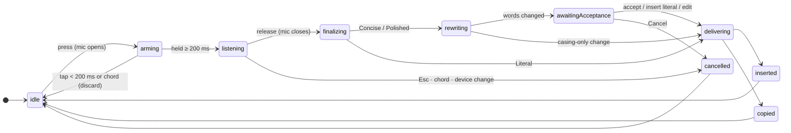
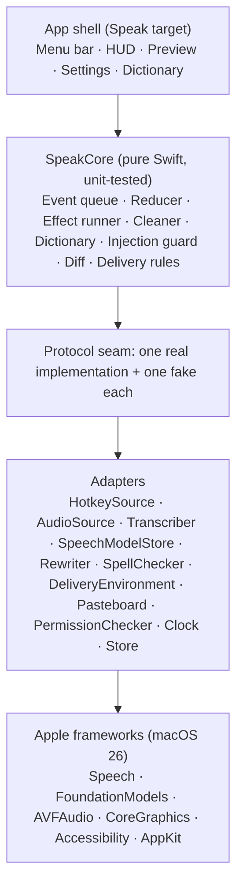

# Speak — Architecture v1

> Status: **design baseline**, October 2026. Open [`v1.html`](v1.html) in a browser for the interactive walkthrough.

Speak is a macOS menu-bar app. Hold a key, talk, let go, and clean text appears at your cursor in any app. Speech recognition and rewriting run on your Mac with Apple frameworks:
- **0** network calls
- **0** bytes of audio on disk
- **$0** running cost
- **≤1.5 s** median release-to-text target in Literal mode (≤3 s with a rewrite)

## Pipeline

## Session state machine

One pure reducer, `reduce(state, event) -> (state, [effect])`, owns every session. All inputs arrive on a single ordered queue, so no two events can race. Every async result carries a session token, and results from an old session are dropped.

The microphone is open **only** in `arming` and `listening`. Watchdogs bound every wait: a transcriber start (3 s), finalize (5 s, then the partial text is used), a rewrite (2.5 s, then literal), and a lost key-up (300 ms).

## Delivery checks

The checks are evaluated in order, immediately before pasting. The first failure copies the text and names the reason.

| # | Check | If it fails |
|---|---|---|
| 0 | Is there any text? | nothing: "Didn't catch that" |
| 1 | Is Accessibility granted (checked fresh)? | copy: Accessibility not granted |
| 2 | Is secure input off (password fields)? | copy: Secure input is on |
| 3 | Is it the same app as at key press (by PID)? | copy: App changed |
| 4 | Is a text field focused (when the system can tell)? | copy: No text field focused |
| 5 | Is it the same field as at key press? | copy: Focus moved |
| 6 | Are the modifier keys released? | copy: Release modifier keys |
| 7 | All clear | **paste** with ⌘V, then restore the clipboard unless it changed |

## Layers

`SpeakCore` never imports AppKit, AVFoundation, Speech, or FoundationModels, and CI enforces this. The whole pipeline runs in tests and CI with fakes and no microphone.

## Privacy guarantees and how they're enforced

| Guarantee | Enforced by |
|---|---|
| No network | No networking code or entitlement; a CI privacy check fails on any network API |
| No audio on disk | Buffers stream and are released; tests assert no file I/O in the audio path |
| The mic opens only while you hold the key | Two mic states, closed on every exit; a property test over 1,000 random event sequences |
| No silent rewrites | Changed words need explicit acceptance; rejecting leaves the literal byte-identical |
| No sensitive logs | Only enums, numbers, and durations are logged publicly; never text, app names, or window titles |

## Failure modes and design responses

| Failure mode | Design response |
|---|---|
| Two events race inside one transition | A single ordered queue feeding a synchronous reducer |
| Late result from a cancelled session | Session tokens on every async result; mismatches are dropped |
| Speech or model framework hangs | Watchdogs on start, finalize, and rewrite; a restart prompt after repeated hangs |
| ⌘V sent while Option is still held | Wait for modifiers; explicit flags; layout-resolved "v" key |
| Accepting the preview pastes into Speak itself | Re-activate the original app by PID before delivery |
| Clipboard restored before a slow app reads it | Longer delay for slow apps; restore only if unchanged; skip lazy types |
| First word lost to the tap/hold debounce | The mic opens at press; taps and chords are discarded |
| Rewrite answers or obeys the dictation | Bracket stripping, single tagged output, length and overlap checks, literal fallback |
| On-device model slow on its first call | Prewarm at launch and when listening in a rewrite mode |
| Dictionary "fixes" real words | Fuzzy matching only for words the spellchecker flags |

## Known limits (v1)
- The hotkey is observed, not intercepted, so the key press and Esc also reach the focused app.
- Undo sends ⌘Z to the target app and is best-effort.
- Concise and Polished need Apple Intelligence enabled. Literal always works.
- On keyboard layouts where Right Option is AltGr, choose Right Command.
- Remote-desktop and VM apps may need the slow-paste list.

## Rejected alternatives
- **Active event tap:** it would need Accessibility and could swallow keys system-wide.
- **XPC helper process:** Apple's speech and model services already run out of process.
- **Setting text through the Accessibility API:** unreliable in Chrome, Electron, and terminals.
- **Keeping the analyzer warm between sessions:** it holds the audio pipeline and memory.
- **Cloud speech-to-text or an LLM API:** these break the privacy and $0 guarantees.

## Roadmap
| Phase | Scope | Hands-on check |
|---|---|---|
| P0 | SwiftPM skeleton, stable signing, scripts | The icon appears; the signature is stable across rebuilds |
| P1 | Hotkey, mic, on-device speech, delivery, HUD (daily driver) | Dictate into four apps and a password field |
| P2 | Dictionary, Concise/Polished, diff preview, undo | A misspelled name is fixed; a rewrite is rejected |
| P3 | History, launch at login, icon, CI, README, demo GIF | The QA checklist is complete; CI is green |
